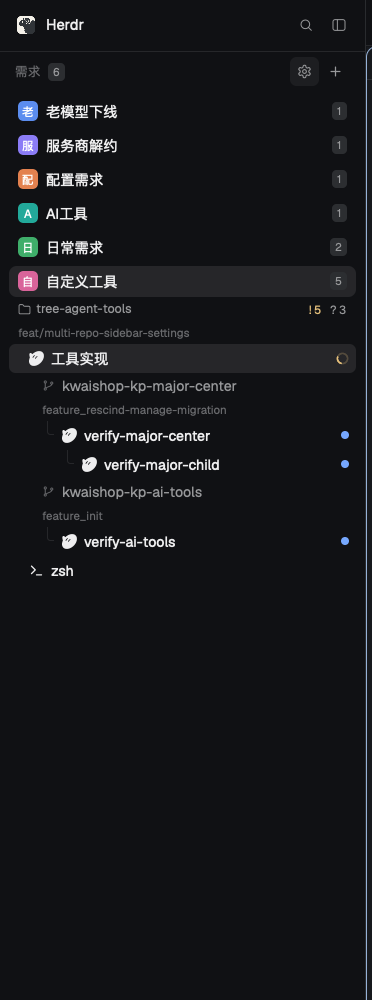

# tree-agent-tools

Agent 工具集合，目前包含 Herdr Desktop 的侧边栏 mod。

## Herdr mods

### Multi-Repo Sidebar

把 Herdr 的 space 组织成「需求 → 工作区仓库 → 代码仓库 → Agent / 子 Agent」的侧边栏。需求行展示工作区仓库；直接子 Agent 按其 git 仓库聚类，仓库名作为弱化描述，Agent 作为视觉主体；分支单独一行，并显示 powerlevel10k 风格的 git 状态（`!N`、`+N`、`?N`、`✘N`、`⇡N`、`⇣N`）。



- 源码和分享包：`herdr-mods/multi-repo-sidebar/`
- 构建说明：`herdr-mods/multi-repo-sidebar/RECIPE.md`
- 分享 layout：`herdr-mods/multi-repo-sidebar/layouts/Multi-Repo-Sidebar.json`
- 安装：

```bash
cd herdr-mods/multi-repo-sidebar
./sync.sh        # 安装 mod，并把 Multi-Repo-Sidebar layout 放进 Herdr 设置
./sync.sh --use  # 安装后直接切换
```

Herdr 设置只列 `layouts/`，不列 `mods/`。`sync.sh` 会同时安装 layout，因此安装完成后可以在 `Settings → Look → Layout` 看到名为 `Multi-Repo-Sidebar` 的卡片（缩略图使用 Herdr 默认样式）；也可以直接执行：

```bash
herdr-app do layout.switch '{"name":"Multi-Repo-Sidebar"}'
```

如果要接入自己的 layout，把侧边栏里的 `spaces` 和 `agents` 换成一个 block：

```json
{
  "id": "requirements",
  "type": "block",
  "size": { "weight": 1 },
  "min": 90,
  "content": { "mod": "multi-repo-sidebar" }
}
```

注意：该 mod 会通过 `exec("git")` 读取仓库状态，并用 `watchFolder` 监听本地仓库目录；不发起网络请求。详见 `RECIPE.md` 的 **Watch out**。

## 仓库结构

```text
herdr-mods/
  multi-repo-sidebar/      # Herdr mod 分享包
    layouts/               # Herdr 设置里可见的 layout 卡片
    mods/multi-repo-sidebar/
    RECIPE.md
    preview.png
    sync.sh
    tests/
docs/plans/                # 设计与实施计划
```

## 开发

```bash
cd herdr-mods/multi-repo-sidebar
node --test tests/*.test.mjs
herdr-app check mods/multi-repo-sidebar
```

## License

Apache License 2.0，见 `LICENSE`。
