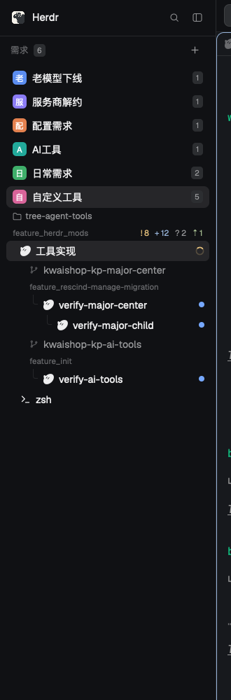

# Multi-Repo Sidebar

A Herdr sidebar mod for requirements that fan out across several repositories. Each space becomes a requirement, the workspace repository and its agents sit underneath it, and the repositories that the workspace agent spawned its sub-agents into are shown as dim labels above those agents. Branch names and powerlevel10k-style git state are on their own line, so long project names no longer hide them.



## What you see

The mod fills one sidebar block. The recommended width is 280px; the block needs `min: 90`, and below 160px it switches to a compact rail.

- **Header**, 40px tall: a 11.5px `dim` label `需求`, a 16px-tall count pill, and a 26px `+` button.
- **Requirement row**, 28px tall: an 18px colored avatar, the requirement name in `foreground`, a live-terminal count pill, and — when the row is the active space — the `selected` background. The avatar color is the stored `space.colors` value or a deterministic color from the name.
- **Workspace repository line**, 23px tall, flush left with the requirement name: a 12px folder icon in `muted`, then the workspace repository name in `muted`.
- **Workspace branch line**, 20px tall, left-aligned with the folder icon: 10.5px branch name in `dim`, followed by git state. Long branches get their own line instead of being truncated behind the repository name.
- **Top-level agent**, 26px tall, indented 12px, with no tree glyph. When the tab has one top-level agent and is named, the row uses the tab name; otherwise it uses the terminal title. It shows the program icon and agent status on the right.
- **Repository label**, 24px tall, indented 24px: a 12px branch icon and repository name both in `dim`; a count pill appears when more than one direct agent lives in that repository.
- **Repository branch line**, 20px tall, left-aligned with the repository icon: branch name in `dim` and git state on the right.
- **Repository agents and sub-agents**, 26px tall: repository agents are indented 24px and use a 12px tree rail; deeper sub-agents keep the same rail style at 12px per level. Agent names use `foreground`, so agents read as the subject and repositories read as descriptions. Agent status is on the right.
- **Rail below 160px**: 32×28 requirement cells with the 18px avatar and a `»` control at the bottom.

All colors come from `theme()`: `chrome`, `border`, `foreground`, `muted`, `dim`, `selected`, `hover`, `working`, `accent`, `blocked`, `ansi1`, `ansi2`.

## How it behaves

Agent status, right side of terminal rows:

- `blocked`: 14px rounded badge with `!` on a `blocked` tint.
- `working`: 12px spinner, `900ms` rotation.
- `done`: 7px filled `done` dot.
- `idle`: 7px ring in `idle`/`dim`.
- Plain terminals with no agent status show nothing.

Git state, after the branch name:

- `!N` uncommitted changes, `working` color.
- `+N` staged changes, `accent` color.
- `?N` untracked files, `muted` color.
- `✘N` conflicts, `blocked` color.
- `⇡N` commits to push, `ansi2` color.
- `⇣N` commits to pull, `ansi1` color.
- Icon and number are separate 10.5px text nodes with `gap(2)`; status groups have `gap(7)`.

Clicks and keys:

- Requirement row, inactive: `run("space.select", { id })`.
- Requirement row, active: toggles collapse. Collapsed IDs persist in `localStorage` under `multi-repo.collapsed`.
- Requirement row, right click: `openOverlay` with the `menu` mod, `props: { tab: "space", target: { id } }`.
- Workspace repository line: `run("space.select", { id })`.
- Repository label: focuses its first agent.
- Terminal with a pane: `run("pane.focus", { pane })`.
- Terminal with no pane (a child sub-agent): `run("terminal.peek", { terminal })`, which opens the peek window.
- Narrow rail avatar: selects the space. `»`: restores `sidebar.width` from `shared()` or calls `run("layout.resize", { id: "sidebar", px: 76/44 })`.

Branch data loads after 500ms, then a 1500ms tick checks the 15s TTL. Up to six git reads run at once. Local repository roots are watched with `watchFolder`; a change only marks the cache stale, so the last branch/status stays visible while the next read runs. The view only redraws when a visible branch or status value actually changes.

## Built from

```text
mods/multi-repo-sidebar/
  mod.json
  main.js
  lib/model.js
  lib/branches.js
  lib/ui.js
  icons/{branch,chevron-down,chevron-right,folder,plus,spinner}.svg
  THIRD_PARTY.md
```

`mod.json`:

```json
{ "version": "0.1.0", "place": "none", "title": "Multi-Repo Sidebar" }
```

Add the mod to any layout:

```json
{
  "id": "requirements",
  "type": "block",
  "size": { "weight": 1 },
  "min": 90,
  "content": { "mod": "multi-repo-sidebar" }
}
```

The example layout is kept outside this mod folder at `herdr-mods/examples/multi-repo.json`; no layout is shipped with the mod.

Data path:

- `spaces()`, `agents()`, `terminals()`, `panes()`, `focused()`, `layout()` from `herdr`.
- All live terminals in a space enter one tree. A terminal without `herdr.space` inherits the space from its parent; if the parent is gone, the `where` label is a fallback.
- Workspace repository: the first live top-level terminal's `cwd` that is not `home()`, else `space.folder`. Repository name and branch come from git.
- Direct children of each top-level agent are grouped by their git root (`git rev-parse --path-absolute --show-toplevel`), not by the immediate `cwd`. Same root means one repository label. Deeper sub-agents stay under their parent.
- The workspace repository's branch status is read from its own `cwd`; each repository label reads its own first agent `cwd`.

Herdr API and commands used:

- Views: `View`, `div`, `v_flex`, `h_flex`, `ScrollHandle`.
- Read: `spaces`, `agents`, `terminals`, `panes`, `focused`, `layout`, `theme`, `home`, `window`, `shared`, `checking`.
- Actions: `run("space.select")`, `run("space.new")`, `run("pane.focus")`, `run("terminal.peek")`, `run("layout.resize")`, `openOverlay`, `setAgentOrder`, `setShared`.
- Process/files: `exec("git", ...)` and `watchFolder(repoRoot)`.

Git reads, per repository `cwd`:

```sh
git rev-parse --path-format=absolute --show-toplevel
git --no-optional-locks status --porcelain=v2 --branch --untracked-files=normal
```

`lib/branches.js` parses porcelain v2: `# branch.head`, `# branch.upstream`, `# branch.ab`, `1`/`2` entries, `u` conflicts, `?` untracked. Cache key is `[machine ?? "", cwd]`; entries are `{ repoRoot, branch, upstream, ahead, behind, stagedCount, unstagedCount, untrackedCount, conflictedCount, checkedAt }`.

No `keys.json`: this mod defines no default shortcuts.

Icons are six Lucide SVG files, ISC licensed; `THIRD_PARTY.md` carries the notice.

## Watch out

- **This mod runs programs and reads outside its own folder.** It calls `exec("git", ...)` in each visible repository `cwd`, and watches local repository roots with `watchFolder`. It makes no network requests. Git failures keep the last successful value and retry later.
- `git --no-optional-locks status` is required. Without the flag, Herdr's git process can create `.git/index.lock` when the project being viewed is the same repository that contains the mod, which blocks other git commands and causes the sidebar to look like it is twitching.
- `git status --porcelain=v2` must be supported. Parse failures leave the previous branch/status in place.
- The mod folder name is part of every icon path (`mods/multi-repo-sidebar/icons/...`). Renaming the folder requires changing `Icon()` and `ProgramIcon` asset paths.
- `place: "none"` means the mod draws nothing until a layout block points at it. No layout is included.
- There is no aggregate status and no repository/sub-agent fold. Only requirement collapse exists.
- Only `state: "live"` terminals are shown. Finished sub-agents disappear; the branch cache is in memory and disappears on reload.
- The workspace repository line follows the first live top-level terminal, not `space.folder`, unless all live terminals are in `home()`. A space whose agent moved to another repository will show the moved repository.
- A child sub-agent with no pane cannot be focused like a pane; `terminal.peek` opens its peek window instead.
- `watchFolder` is capped at 64 roots. Remote repositories rely on the 15s TTL instead of local folder watching.
- The preview uses test agents created with `hc run`; they are not part of the build.

## Done when

1. `herdr-app check mods/multi-repo-sidebar` prints `check passed`.
2. Add the block above to a layout, switch to it, and the sidebar shows requirement rows, a workspace repository line, a branch line, and top-level agents.
3. A repository with more than one live child agent shows one dim repository label and one agent row per child; a child sub-agent under an agent has a tree rail and opens a peek window when clicked.
4. The branch line shows the current branch and at least one git state icon (`!N`, `+N`, `?N`, `✘N`, `⇡N`, or `⇣N`) with the icon and number separated by `gap(2)`.
5. Clicking the active requirement row collapses and expands the workspace; clicking an inactive one selects it. Narrowing the sidebar below 160px shows the rail.
6. `herdr-app status` reports `errors: []` after switching layouts.
